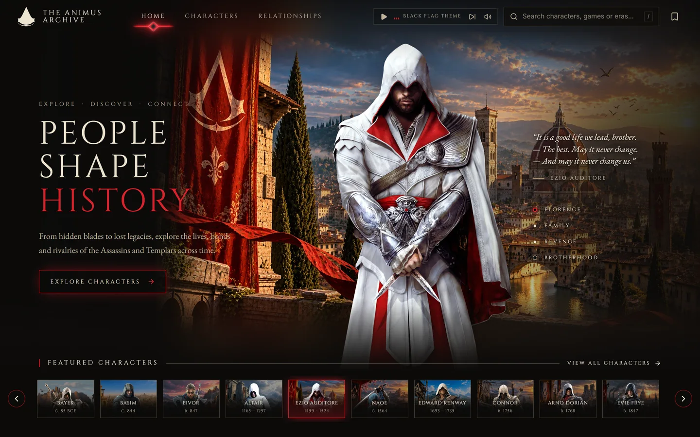
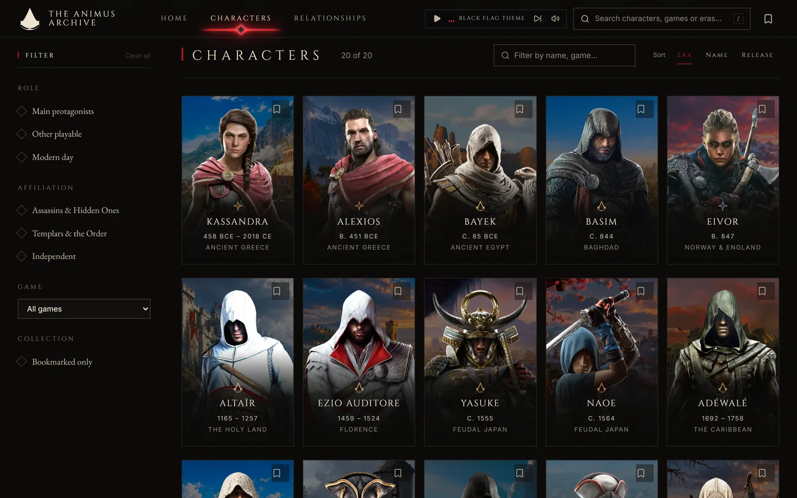
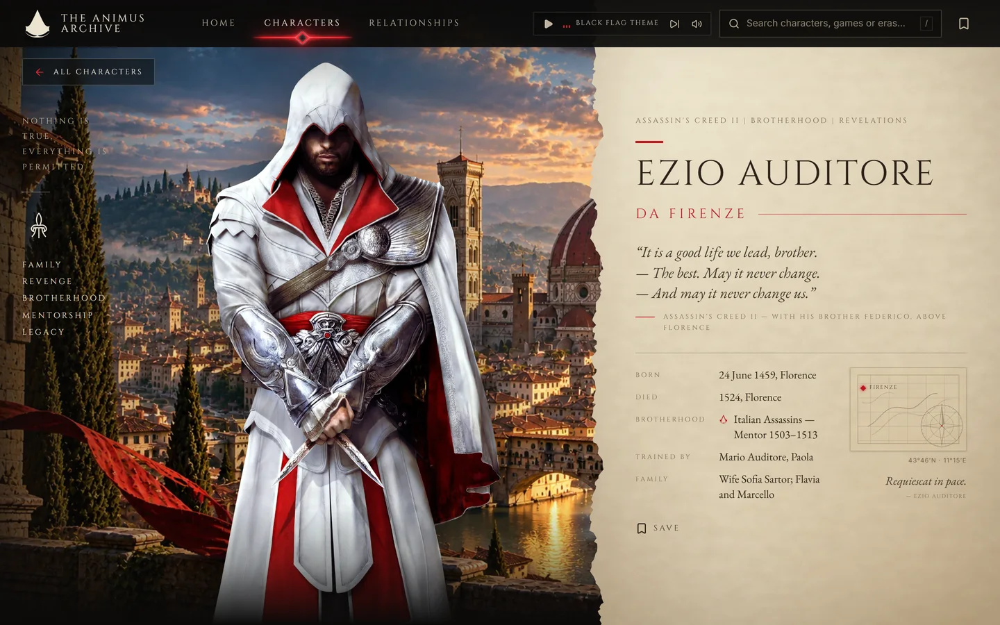
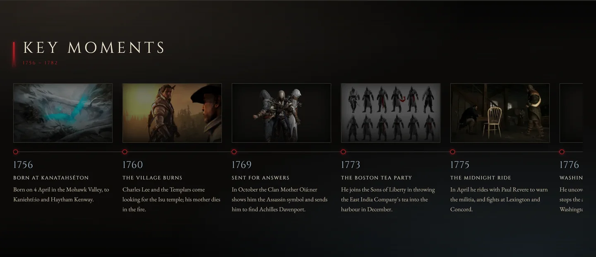
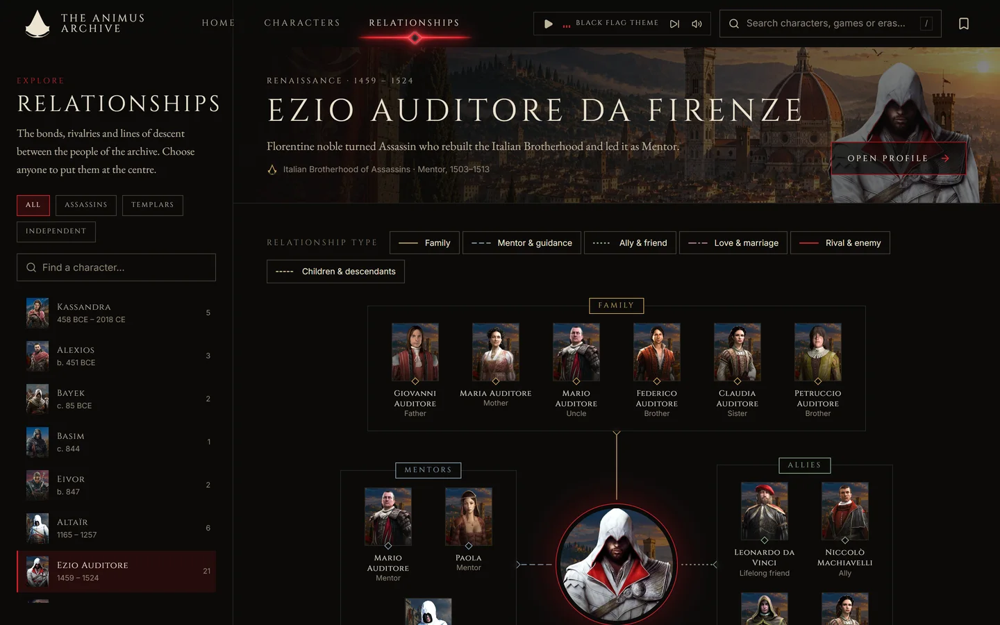
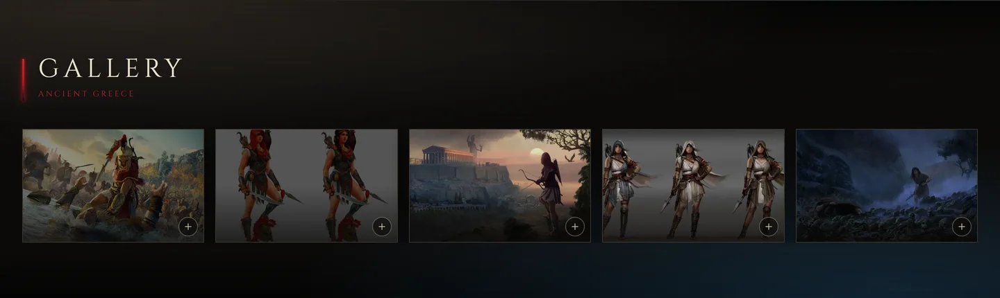
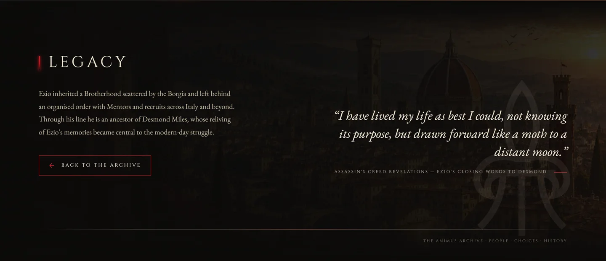

<div align="center">

# The Animus Archive

**Twenty lives. Two thousand years. One archive.**

An unofficial, fan-made encyclopaedia of the people at the centre of *Assassin's Creed*:
who they were, who shaped them, and what they left behind.

</div>



## Never played Assassin's Creed?

You don't need to have. Here's the whole premise in a paragraph.

Each game drops you into a different century as a different person. Renaissance Florence.
The Caribbean in the golden age of piracy. Ptolemaic Egypt, Viking England, revolutionary
Paris, Sengoku Japan. Running underneath all of it are two orders that have been fighting
for about as long as there has been history: the Assassins, who think people should be free
to choose badly, and the Templars, who think people are safer when someone chooses for them.

Most of the people in here picked a side. A few switched. One of them killed his own father
over it, and one of them was that father.

This site is the place they all stand next to each other. Every page tells you who someone
was, when they lived, who mattered to them, and where the facts came from.

## What's in it

### The archive

Twenty playable leads across ten eras, filterable by era, role, affiliation and game.
Search is fuzzy and understands accents, so `altair` finds Altaïr and `black flag` finds
everyone who was in it. Bookmarks are kept in your browser.



### A profile

Each one opens on a dossier: their own words where a line of theirs is recorded, the facts
that are actually known, and a map fragment with their city pinned on it. The name is sized
from measured letter widths so it fills its column on one line, whether it's "Evie Frye" or
"Ratonhnhaké:ton".



### Key moments

A checked timeline for every character, dated against the wiki. Where a date is genuinely
uncertain the event is left out rather than guessed, which is why some timelines are shorter
than others.



### Relationships

Family, mentors, allies, rivals, love and the next generation, each in a fixed slot around
the person. Lines are measured from the rendered boxes, so they stay attached at any width.
Click anyone to re-centre the map on them.



### Gallery

Concept art and key art for each character, opening full-screen.



### The close

Every profile ends on a panorama of their world and the line they're remembered by.



## Where the facts and the artwork come from

This part matters more than the design does.

- **Nothing is invented.** Dates, relationships and quotes are checked against the
  [Assassin's Creed Wiki](https://assassinscreed.fandom.com) and Wikipedia. Every profile
  lists its sources at the foot of the page. An unknown date is omitted, not guessed.
- **Quotes are real or they aren't quotes.** A character with no recorded line gets an
  editorial summary instead, set without quotation marks so it can't be mistaken for one.
- **The artwork is official.** Character renders, concept art and key art by Ubisoft and its
  artists, listed in `scripts/art/sources.json` and composed by a local pipeline. No fan art
  and no AI-generated stand-ins.
- Some things the games themselves leave ambiguous, like which of Kassandra and Alexios was
  the Eagle Bearer, are noted on the page rather than quietly resolved.

## Built with

Next.js 16 (App Router, Cache Components), React 19, TypeScript and Tailwind 4. Artwork is
prepared ahead of time by a `sharp` pipeline, so nothing is resized at request time: every
figure and setting is written at several widths and picked with `srcset`. Profiles are fully
prerendered.

## Running it

```bash
npm install
npm run dev      # http://localhost:3000
npm run build
npm run lint
```

The committed artwork is enough to run the site. To rebuild it from the sources:

```bash
npm run art:fetch   # download the sources into .art-cache/ (git-ignored)
npm run art:build   # compose public/images/ and the manifest
```

Drop any audio files into `public/audio/` and they show up in the header player.

## Deploying

Everything is prerendered, so any host that runs a Next.js build will do. Vercel needs no
configuration beyond importing the repo.

Set one environment variable so share cards, canonical links and the sitemap use real URLs:

```
NEXT_PUBLIC_SITE_URL = https://your-domain
```

It is read at **build** time, not at runtime, so a change to it needs a redeploy. On Vercel you
can skip it entirely: the build falls back to `VERCEL_PROJECT_PRODUCTION_URL`. Without either,
URLs fall back to `http://localhost:3000`, which is fine locally and wrong in production.

`/sitemap.xml` and `/robots.txt` are generated from the character list, so new characters appear
in both without any extra step.

## Layout

| Path | What's there |
| --- | --- |
| `data/characters.ts` | Every character and their timeline, typed by `data/types.ts` |
| `data/relationships.ts` | Every relationship, stored once; both maps derive from it |
| `app/` | Routes: home, characters, profiles, relationships |
| `components/` | Profile sections, the relationship map, directory, header, player |
| `lib/art.ts` | Artwork lookup over `public/images/manifest.json` |
| `lib/typeset.ts` | Measured Cinzel widths, used to fit a name to its column |
| `scripts/art/` | Fetch and composition pipeline |
| `docs/` | `architecture.md` for how it all fits together, `design-reference.md` for design decisions, `assets.md` for the art manifest |

## How it works

[`docs/architecture.md`](docs/architecture.md) walks through the whole project: the four
layers and the rule they follow, the derived relationship graph, the font-metric heading
system, the build-time image pipeline, and what each file is for.

## Credits

Assassin's Creed, its characters and its artwork belong to Ubisoft Entertainment. This is a
non-commercial fan project and is not affiliated with or endorsed by Ubisoft. Facts are
checked against the community Assassin's Creed Wiki and Wikipedia.
